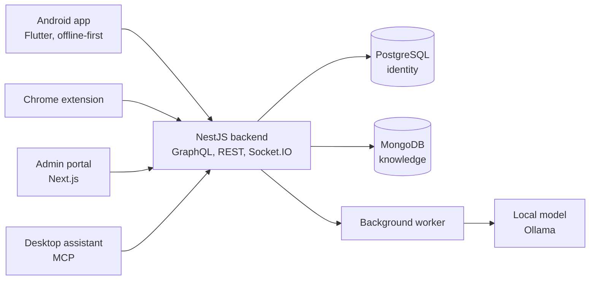

# JARVIS

A private second brain: capture anything, recall it with sources, act on it.

**[See it live](https://live-jarvis.vercel.app/)** · The source code is private. This page describes how it is built.

## What it does

- Captured thoughts, links, photos and videos, then filed them automatically.
- Answered questions from your own notes and cited the sources used.
- Turned saved material into tasks, reminders and a weekly review.
- Ran the model on your own machine through Ollama, so member data never went to a cloud model.

## How it is built

## Key decisions

- Kept AI local: privacy mattered more than the strongest available model.
- Stored every capture as-is before classifying it, so nothing was lost if filing failed.
- Scoped every row to one member, so retrieval could not reach another member's data.
- Queued captures on the device and filed them once the connection returned.
- Required confirmation before an assistant's proposed change was applied.

## Stack

NestJS · PostgreSQL · MongoDB · Flutter · Next.js · Chrome extension · MCP · Ollama · Docker
